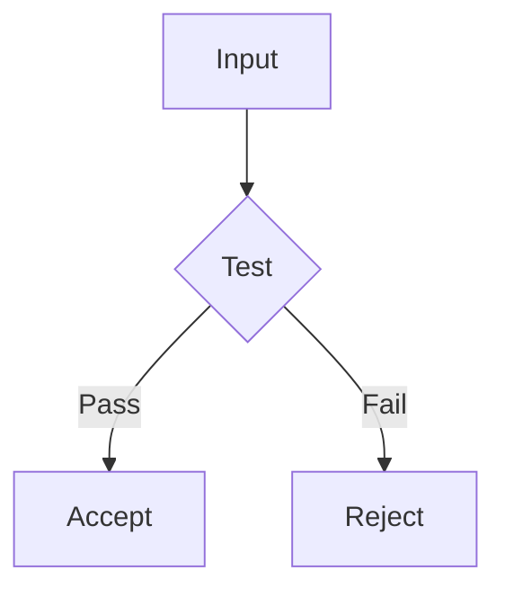
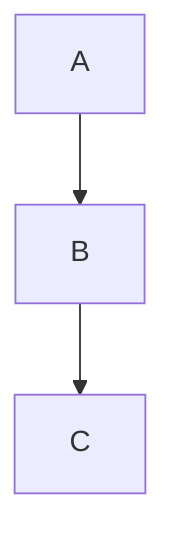
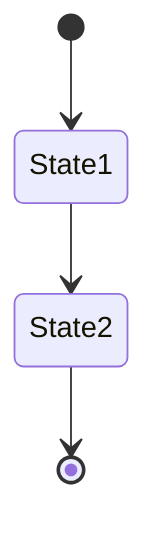
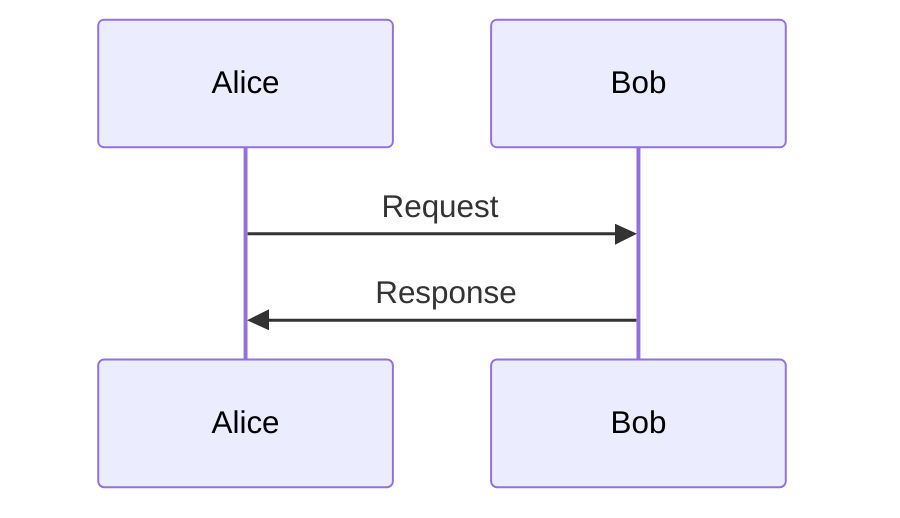

# ADR-0008: Mermaid Plugin Integration for Reveal.js Slides

- **Date**: 2026-02-12
- **Iteration**: 1
- **Status**: Accepted
- **Deciders**: Jérémie Lumbroso, Claude Sonnet 4.5

---

## Context

Lecture 6 introduces algorithmic flowcharts and decision diagrams (grand jury as "Call Before You Go", Morris approximate counting). We need to visualize:
- Decision trees (if/then branches)
- Algorithmic flow (probabilities, state transitions)
- Process diagrams (cheap → expensive paths)

**Problem**: Static images don't integrate well with reveal.js styling and require separate creation tools.

**Solution**: Mermaid.js enables inline diagram generation using markdown-like syntax, rendered directly in slides with consistent styling.

---

## Decision

### Integrate Mermaid Plugin for Reveal.js

Use the official `reveal.js-mermaid-plugin` to enable Mermaid diagram rendering in lecture slides.

---

## Implementation

### 1. Add Mermaid Plugin Script

In HTML `<head>`:

```html
<script src="https://cdn.jsdelivr.net/npm/reveal.js-mermaid-plugin@11.12.2/plugin/mermaid/mermaid.js"></script>
```

**Note**: Version 11.12.2 is pinned for stability. Update only when testing confirms compatibility.

### 2. Configure Reveal.js Initialization

```javascript
Reveal.initialize({
	hash: true,
	slideNumber: 'c/t',
	showNotes: false,
	transition: 'slide',
	backgroundTransition: 'fade',
	mermaid: {
		theme: 'default',
		themeVariables: {
			primaryColor: '#CC7C5E',      // Claude orange (matches headings)
			primaryTextColor: '#333',
			primaryBorderColor: '#CC7C5E',
			lineColor: '#CC7C5E',
			secondaryColor: '#E8F4F8',    // Slido blue (interactive elements)
			tertiaryColor: '#53B467'      // Claude green (links)
		}
	},
	plugins: [RevealNotes, RevealMermaid]
});
```

### 3. Diagram Syntax in Slides

**Flowchart Example:**
```html
<section>
	<h2>Decision Flow</h2>
	<div class="mermaid">
		<pre>
graph TD
	A[Start] --> B{Condition}
	B -->|Yes| C[Action 1]
	B -->|No| D[Action 2]

	style B fill:#E8F4F8
	style C fill:#d4edda
	style D fill:#f8d7da
		</pre>
	</div>
</section>
```

**State Diagram Example:**
```html
<div class="mermaid">
	<pre>
graph LR
	A[Event] --> B{Coin Flip}
	B -->|Heads| C[C = C + 1]
	B -->|Tails| D[C = C]
	C --> E[Estimate: 2×C]
	D --> E
	</pre>
</div>
```

---

## Styling Guidelines

### Color Coding for Algorithmic Concepts

Use consistent colors to map concepts:

| Concept | Color | Hex | Usage |
|---------|-------|-----|-------|
| Cheap/Fast operations | Light blue | `#E8F4F8` | Heuristic checks, filters |
| Expensive/Slow operations | Light red | `#f8d7da` | Full computation, trials |
| Success states | Light green | `#d4edda` | True positives, correct outcomes |
| Neutral/Start states | White | `#ffffff` | Initial states, data input |

**Example:**
```mermaid
style CheapCheck fill:#E8F4F8
style ExpensiveOperation fill:#f8d7da
style SuccessOutcome fill:#d4edda
```

### Typography

- **Node labels**: Keep under 3 words when possible
- **Line breaks**: Use `<br/>` in node text for readability
- **Font size**: Mermaid auto-scales, but test at presentation resolution

---

## Best Practices

### 1. Diagram Complexity

**Good:** 3-7 nodes, 1-2 decision points


**Too complex:** >10 nodes, multiple branches
- Solution: Break into multiple slides or use PDF image

### 2. Wrapping in `<pre>` Tags

**Always wrap Mermaid syntax in `<pre>` tags** inside the `.mermaid` div:
```html
<div class="mermaid">
	<pre>
		<!-- Mermaid syntax here -->
	</pre>
</div>
```

This preserves whitespace and prevents HTML parsing issues.

### 3. Testing Diagrams

Before slides:
1. Test at https://mermaid.live/
2. Copy working syntax to slides
3. Verify rendering in reveal.js locally
4. Check at presentation resolution (1920x1080 fullscreen)

### 4. Fallback Strategy

If Mermaid fails to load:
- Keep static image backup in `/images/` folder
- Add `<noscript>` fallback:
```html
<div class="mermaid">
	<pre>graph TD...</pre>
	<noscript>
		
	</noscript>
</div>
```

---

## Diagram Types Available

Mermaid supports many diagram types. Relevant for this course:

### 1. Flowchart (graph)
**Use for**: Algorithmic flow, decision trees, "Call Before You Go" patterns



### 2. State Diagram (stateDiagram-v2)
**Use for**: State machines, automata, protocol flows



### 3. Sequence Diagram (sequenceDiagram)
**Use for**: Protocol interactions, API calls, message passing



### 4. Gantt Chart (gantt)
**Use for**: Timeline diagrams, algorithm phases

---

## Integration with ADR-0007 (CSS Baseline)

Mermaid diagrams respect the same design system:
- `--r-heading-color: #CC7C5E` → Use for primary nodes
- `--r-link-color: #53B467` → Use for success states
- `.slido-slide` background `#E8F4F8` → Use for interactive/heuristic nodes

**Consistent experience**: Diagrams feel native to slide deck.

---

## Limitations

### 1. Performance
- **Impact**: Minimal for <5 diagrams per deck
- **Heavy load**: >10 diagrams may slow rendering
- **Solution**: Use static images for complex diagrams

### 2. Browser Compatibility
- **Chrome/Edge**: Full support
- **Firefox**: Full support
- **Safari**: Mostly works (test on macOS)

### 3. Print/PDF Export
- Mermaid diagrams may not export cleanly to PDF
- **Workaround**: Screenshot rendered diagrams for PDF handouts

---

## Maintenance

### Version Updates

Check for updates quarterly:
```bash
npm view reveal.js-mermaid-plugin version
```

**Current**: 11.12.2
**Update policy**: Only update between semesters, never mid-course

### Breaking Changes to Watch

- Mermaid.js major version updates (9.x → 10.x)
- reveal.js major version updates (4.x → 5.x)
- Theme variable changes in either library

---

## Example: Lecture 6 Usage

### Grand Jury as Filter
```html
<div class="mermaid">
	<pre>
graph TD
	A[Allegation] --> B{Grand Jury<br/>CHEAP}
	B -->|No Indictment| C[Case Ends<br/>Days, $1000s]
	B -->|Indictment| D[Full Trial<br/>EXPENSIVE]
	D --> E[Months, $Millions<br/>Precedent]

	style B fill:#E8F4F8
	style D fill:#f8d7da
	</pre>
</div>
```

### Morris Counting
```html
<div class="mermaid">
	<pre>
graph TD
	A[C=1] -->|p=1/2<br/>~2 calls| B[C=2]
	B -->|p=1/4<br/>~4 calls| C[C=3]
	C -->|p=1/8<br/>~8 calls| D[C=4]
	D -->|p=1/16<br/>~16 calls| E[C=5]

	F[Total: 30 calls] --> G[Estimate: 2^5-2 = 30]
	</pre>
</div>
```

---

## Consequences

### Positive
- **Inline editing**: Update diagrams without leaving HTML
- **Consistent styling**: Auto-matches course color scheme
- **Version control**: Diagrams are text, diff-able in git
- **Rapid prototyping**: Test diagram ideas in real-time

### Negative
- **Learning curve**: Mermaid syntax for team members
- **Dependency**: External CDN (mitigated by version pinning)
- **Limited customization**: Some styling constraints vs custom SVG

### Trade-offs Accepted
We prioritize **rapid iteration** over **pixel-perfect control**. For complex diagrams requiring fine-tuning, we'll use static images.

---

## Action Items

- [x] Document Mermaid integration in ADR-0008
- [x] Add Mermaid to lecture06 slides template
- [ ] Test Mermaid diagrams at presentation resolution
- [ ] Create Mermaid cheat sheet for common patterns
- [ ] Update CLAUDE.md with Mermaid guidelines reference

---

## Links

- Plugin: https://github.com/zjffun/reveal.js-mermaid-plugin
- Mermaid docs: https://mermaid.js.org/
- Live editor: https://mermaid.live/
- Related ADRs:
  - [ADR-0001](0001-reveal-js-slide-collaboration-workflow.md) - Reveal.js workflow
  - [ADR-0007](0007-reveal-js-css-baseline.md) - CSS baseline
- Implementation: [lectures/lecture06/lecture06-slides.html](../../lectures/lecture06/lecture06-slides.html)

---

## Iterations

### Iteration 1 (2026-02-12)
- **Context**: Lecture 6 requires flowcharts for Morris counting algorithm
- **Decision**: Integrate reveal.js-mermaid-plugin with course color scheme
- **Implementation**: Added to lecture06 slides, documented patterns
